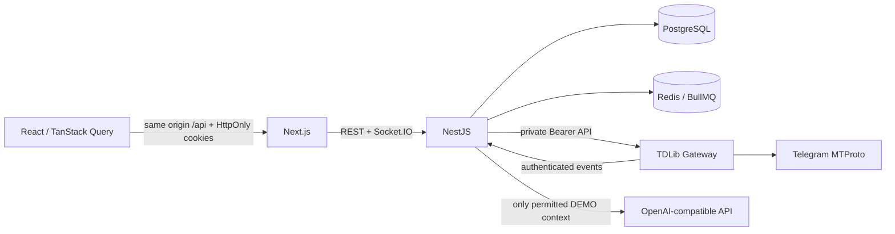

# Архитектура Sales Copilot

Backend остаётся модульным монолитом. Отдельный Gateway изолирует нативную TDLib и сессии. Контракт `ChannelAdapter` и capabilities находятся в `packages/shared`; Instagram пока не реализован. Общие входные данные проверяет Zod, данные API всегда ограничиваются Workspace из живой серверной сессии.

## Данные

Contact, Conversation и Deal — разные сущности. Имена не объединяют людей автоматически. ContactIdentity подготовлен для платформенных идентификаторов; MVP явно привязывает чат к контакту. Составные foreign keys проверяют tenant для связей контактов, продуктов, переписок, сделок, этапов и результатов AI. Stage принадлежит ровно одной Pipeline; составной FK `(stageId,pipelineId,workspaceId)` исключает противоречивую сделку.

Изменения сделки используют integer version compare-and-swap. Создание/перенос сделок, правка стадий и удаление воронки используют общую блокировку Pipeline; при межвороночном переносе блокировки берутся в порядке UUID. Это сохраняет согласованность типа этапа и статуса сделки при параллельных запросах. История сохраняет снимки названий стадий. Редактирование списка стадий блокирует Pipeline и проверяет hash версии; занятый этап удаляется только с явной заменой. Успешное закрытие требует подтверждения пользователя. Nullable Decimal amount отличается от нулевой цены. DEMO-признак распространяется на сделки из демоконтактов, продуктов или чатов, аналитика считает их отдельно.

`PrivacyEngine` контролирует чтение, импорт, отправку и AI. CANDIDATE/EXCLUDED сохраняют только метаданные; CLIENT разрешает содержимое в CRM. При исключении очищаются сообщения, анализы/варианты/usage, задачи и связи сделок; минимальные command digests сохраняются для предотвращения повторной отправки. Gateway получает whitelist выбранных чатов, API повторно проверяет актуальную политику перед записью каждого события. Периодическая уборка удаляет сообщения старше retentionDays и производные анализы.

## Отправка и восстановление

Manual send создаёт MessageCommand и Message в транзакции, с блокировкой политики Conversation. Уникальный `(workspaceId,key)` и hash payload обеспечивают идемпотентность HTTP. BullMQ содержит только ID команды; PostgreSQL outbox остаётся источником истины после потери Redis. Очередь восстанавливается polling по PENDING/SENDING; имена очередей изолированы по БД, тестовые workers не забирают production-команды.

Перед нативным sendMessage Gateway сохраняет intent в SQLite. Одновременные запросы одного ID сериализуются. Журнал содержит hash, attempt, временный и окончательный ID; текст команды отдельно не записывается. Pending TDLib не считается SENT: требуется `updateMessageSendSucceeded`. Известный отказ может быть повторён только новой ручной попыткой; таймаут/неоднозначный сбой становится UNCERTAIN и не разрешает слепого повтора. При перезапуске незавершённый intent считается UNCERTAIN, source events могут уточнить результат. Потеря журнала при resume также не приводит к повторной отправке.

Входящие/исходящие сообщения официального клиента, edit/delete и send confirmation проходят один pipeline. IntegrationEvent dedupe и уникальный source ID предотвращают дубли. Историческая синхронизация не увеличивает счётчик новых непрочитанных сообщений. WebSocket события несут идентификаторы, UI заново читает API; reconnect/refresh не выполняет send. Socket.IO использует polling с возможностью websocket upgrade через same-origin Next proxy. При reconnect клиент проверяет сессию через HTTP, обновляет истёкший access cookie через refresh и перечитывает данные, пропущенные во время разрыва.

## Gateway и секреты

`tdl` + закреплённая prebuilt TDLib; `use_secret_chats=false`, `use_message_database=false`, `use_file_database=false`. Каждая пара Workspace/Connection имеет свой каталог и 32-byte HKDF encryption key. TDLib database шифруется своим native механизмом; callback outbox шифруется AES-256-GCM. Master key хранится в env отдельно от volume. Коды/2FA-пароли передаются только текущему auth step и не записываются. Нативные логи подавлены, API ошибки редактируются.

Gateway не опубликован на хосте Compose. Все private routes требуют constant-time Bearer token, callback API проверяет тот же token и tenant IDs. Health загружает настоящую нативную библиотеку и не требует Telegram API credentials. Без credentials подключение честно недоступно.

## AI

`AiService` строит контекст только после `PrivacyEngine.ai`: разрешён исключительно DEMO + CLIENT. Telegram по умолчанию запрещён, bypass отсутствует. Контекст включает последние допустимые сообщения с UUID, ограниченные продукты/материалы бизнеса, сделки и стадии. Hash версии учитывает изменения сообщений, бизнеса, продуктов, знаний, сделок и стадий; во время generation и при применении версия проверяется повторно.

Провайдеры: disabled, явно подписанный rule-based demo, OpenAI-compatible Structured Outputs. System prompt отделяет инструкции от недоверенного JSON-контекста; модель не получает tools или доступ к sendMessage. Zod проверяет output и provenance подтверждённых фактов. Public reasoning_summary содержит короткое обоснование, не внутреннюю цепочку рассуждений. APPLIED/REJECTED/SENT различаются; SENT ставится после подтверждения исходящего сообщения, edited сравнивает отправленный текст с вариантом. Usage сохраняется только при наличии от провайдера, цена может быть неизвестна.

## Auth и сборка

Opaque access/refresh tokens сохраняются в HttpOnly/SameSite=Strict cookies Path=/api; в PostgreSQL только хеши. Access 15 минут, абсолютный refresh 7 дней. Refresh CAS отзывает старый access и socket, logout отзывает сессию. Socket handshake требует разрешённый Origin/Referer и живое членство; таймер ограничен сроком сессии. Клиентский redirect не заменяет API authorization.

SQL-runner применяет immutable checksum migrations в транзакциях. Prisma 7 JS client генерируется закреплённым WASM-генератором из npm. Node.js 24 нужен также для SQLite Gateway. Docker runtime отделён от build: API production deps/JS/Prisma/SQL, web standalone, Gateway production SDK + нативная библиотека. Telegram volume и ключи нельзя терять при обновлении. Единственный API instance и локальные volumes — текущая граница развёртывания; горизонтальное масштабирование требует распределённого Socket.IO adapter, session ownership и отдельной миграционной процедуры.
