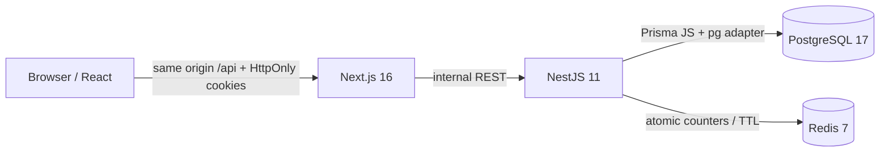

# Архитектура Sales Copilot

## Реализованный Foundation

Это модульный backend, не набор микросервисов. `InfrastructureModule` предоставляет валидированную конфигурацию, Prisma и Redis. `AuthModule` управляет регистрацией и сессиями; `WorkspacesModule` — текущим Workspace; `HealthModule` проверяет реальные зависимости. Направление зависимостей одностороннее: инфраструктура → сервисы → controllers; глобальные guards используют AuthService. Модули CRM и интеграций будут добавляться по этапам, без пустых сервисов и циклических импортов.

Контракты и схемы входных данных разделяются через `@sales/shared`. База и создание владельца — `@sales/database`. UI-компоненты `@sales/ui` следуют паттернам shadcn: Radix Slot, cva, Tailwind tokens, доступные native controls. Next.js генерирует оболочки страниц, реальные защищённые данные запрашиваются из backend через TanStack Query. Клиентский redirect — UX, а не контроль доступа. Токены не попадают в Zustand, localStorage или query cache.

## Данные и транзакции

Сейчас существуют Users, Workspaces, WorkspaceMembers, Sessions, Pipelines, PipelineStages и AuditLogs. Внутренние ID — UUID. User — глобальная учётная запись; членство связывает её с несколькими Workspace. `OWNER`, `ADMIN`, `MEMBER` существуют в БД и проверяются сервером; приглашения и переключение Workspace ещё не реализованы.

Регистрация и seed создают Workspace, владельца, воронку и 7 стадий в одной транзакции. Регистрация также создаёт сессию в той же транзакции. Уникальный email предотвращает дубли; неуспех откатывает весь набор. Обновление Workspace и запись аудита транзакционны.

В бизнес-сущностях есть `workspaceId`. Составной foreign key `(pipelineId, workspaceId)` не позволяет создать стадию воронки другого Workspace. Сессия ссылается на живое членство `(workspaceId, userId)`, поэтому удаление членства удаляет связанные сессии. Обычные foreign keys на User/Workspace также каскадные. В аудит записывается идентификатор актёра, а не пароль или входные данные.

`GET/PATCH /workspaces/current` выбирают tenant только из проверенной серверной сессии. Переданные заголовки, query-параметры и поля тела не могут изменить его. Запись разрешена OWNER/ADMIN. Чтение отдаёт явный select безопасных полей.

## Сессии

Opaque access/refresh tokens: 256 случайных бит каждый. Cookies `sc_access`, `sc_refresh`: HttpOnly, SameSite=Strict, Path=/api, Secure при HTTPS. В БД только SHA-256 token digests. Access действует 15 минут, абсолютный срок сессии — 7 дней. Refresh атомарно меняет оба хеша с условием на предыдущий refresh hash и expiry. В гонке выигрывает ровно один запрос; старый access немедленно недействителен. Frontend объединяет одновременные refresh-запросы внутри одной вкладки. Logout удаляет сессию и cookies.

При логине выбирается самое раннее доступное членство. Изменение роли применяется при следующем запросе, без повторного входа. Проверка Origin обязательна для изменяющих запросов; произвольный cross-origin CORS не включён. Redis хранит атомарные expiring rate-limit counters, не пароли/токены.

## Миграции и сборка

Prisma 7 работает через `@prisma/adapter-pg`; нативный query engine не нужен. `generate-client.mjs` использует закреплённый внутренний генератор Prisma/WASM из npm, без скачивания ненужного schema engine. Это осознанная зависимость от внутреннего API; lockfile и тесты обязательны при обновлении.

SQL-миграции применяет `scripts/migrate.mjs`: advisory lock на соединение, контроль SHA-256 применённых файлов, транзакция для каждой миграции. Таблица `_sales_migrations` — единственный журнал. Prisma Migrate не используется; перед переходом на него потребуется отдельный проверенный baseline, не простое выполнение `prisma migrate deploy`.

Общие Node-пакеты компилируются в CommonJS до API. Next.js компилирует UI. npm lockfile используется в `npm ci`; Docker-образы PostgreSQL/Redis и базовый Node закрепляются digest. Живые процессы после публикации облачной среды должны запускаться заново.

## Следующие архитектурные границы

На этапе 2 отдельно моделируются Contact, Conversation и Deal. Нельзя объединять людей по имени. В каждой сущности и запросе проверяется Workspace; стадии и сделки получают составные ограничения. Канбан будет использовать dnd-kit и backend-транзакцию с историей, с откатом optimistic update при ошибке.

Privacy Engine должен быть единственным входом для сохранения/чтения содержимого диалогов. EXCLUDED не хранит текст, не индексируется и не создаёт сделки; CANDIDATE хранит только минимальные метаданные; CLIENT разрешает CRM по политике, но **не автоматически LLM**. Переход в EXCLUDED должен очищать зависимые данные и производные результаты.

Telegram Gateway (этап 3) — отдельный процесс TDLib. CRM общается с типизированным `MessagingChannelAdapter` и capabilities; Instagram не наследует возможностей Telegram по умолчанию. Идемпотентная команда отправки и её хеш текста сохраняются до обращения к TDLib. Принятие команды ≠ отправленное сообщение: `pending → sending → sent/failed` согласуется с source events; неоднозначный сбой не разрешает слепую повторную отправку. После перезапуска выполняется reconciliation по источнику/чату/message ID. Секретные/защищённые сообщения не импортируются.

AI Service (этап 4) принимает только разрешённый контекст от Privacy Engine и AIPolicyGuard. Реальный Telegram по умолчанию запрещён. Права/политика источника должны быть документированы, без глобального флага обхода. Контекст имеет версию и provenance фактов; внешние тексты считаются данными, не инструкциями. Выход проверяется Zod; рекомендации сохраняются с prompt/provider/usage и признаком устаревания. У AI Service не будет зависимости от метода отправки сообщений.

BullMQ и WebSocket Gateway добавляются при реализации фоновых задач/событий, с изоляцией по Workspace, авторизацией подключения и reconnect/replay. Они ещё не присутствуют в Foundation. Redis сейчас используется для rate limiting, а не как фиктивная очередь.
